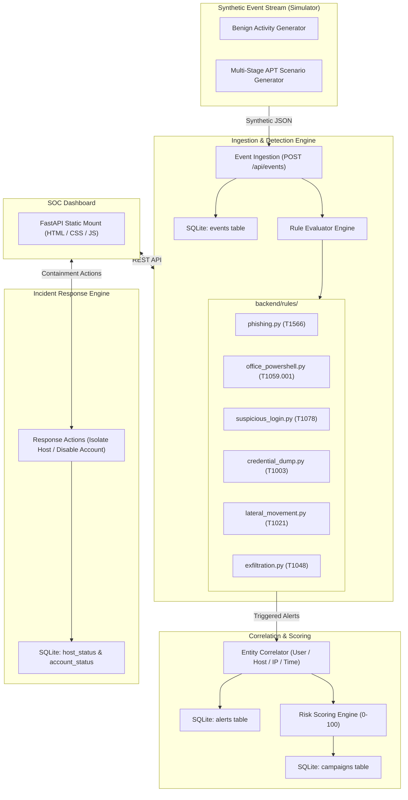

# APT Sentinel — Implementation Plan

> **Tagline**: *"Detect the story, not just the alert."*

## 1. System Vision & Constraints
APT Sentinel is a lightweight, defensive, 100% simulated mini Security Operations Center (SOC) tailored for a hackathon demonstration.

### Key Rules
- **Purely Defensive & Simulated**: Only synthetic JSON log events. No real malware, no real credential dumping, no network attacks. Fully offline capability.
- **Phased Delivery**: Work in strict phases. After each phase, run tests, present results, and pause for approval.
- **Stack**:
  - Python 3.11+
  - FastAPI & Uvicorn (REST API & static file serving)
  - SQLite (standard library `sqlite3`, zero external DB daemon)
  - Pydantic v2 (strict validation and schema serialization)
  - pytest (testing suite)
  - Frontend: Vanilla HTML5, CSS3, ES6 JavaScript (served by FastAPI, no build step, no Node.js required)

---

## 2. Architecture & Data Flow

---

## 3. Data Models Specification

### 3.1 Event (`models.py`)
- `id`: Optional integer (assigned by DB autoincrement) or string
- `timestamp`: ISO 8601 UTC string (e.g. `2026-11-05T10:15:30Z`)
- `host`: Target / source host hostname (e.g. `WORKSTATION-01`, `DC-01`, `FILESERVER-01`)
- `user`: Username or account identity (e.g. `alice.smith`, `bob.admin`, `SYSTEM`)
- `source_ip`: IP address string (e.g. `192.168.1.45`, `10.0.0.12`, `203.0.113.88`)
- `event_type`: Strict enumeration:
  - `attachment_opened`
  - `link_clicked`
  - `process_start`
  - `login_success`
  - `login_failure`
  - `process_access`
  - `network_outbound`
- `details`: Generic dictionary holding event-type-specific attributes (e.g. `file_name`, `process_name`, `parent_process`, `command_line`, `target_process`, `destination_ip`, `destination_port`, `bytes_sent`).

### 3.2 Alert (`models.py`)
- `id`: String identifier (e.g. `ALT-001` or UUID)
- `rule`: Name of the triggering rule (e.g. `Office Spawning PowerShell`)
- `attack_id`: MITRE ATT&CK technique ID (e.g. `T1059.001`, `T1566.001`)
- `stage`: Cyber Kill Chain / ATT&CK stage (e.g. `Initial Access`, `Execution`, `Credential Access`, `Lateral Movement`, `Exfiltration`)
- `user`: Targeted user
- `host`: Affected host
- `timestamp`: ISO 8601 UTC trigger timestamp
- `points`: Integer risk weight contributed by this alert (e.g. 15 to 40)
- `explanation`: Human-readable SOC analyst narrative describing why this was flagged
- `evidence_event_ids`: List of underlying event IDs acting as forensic proof

### 3.3 Campaign (`models.py`)
- `id`: String identifier (e.g. `CMP-2026-001`)
- `entity`: Primary pivot entity string (e.g. `host:WORKSTATION-01` or `user:alice.smith`)
- `stages`: List of distinct stages observed in the attack story
- `alerts`: List of `Alert` objects or alert IDs
- `risk_score`: Normalized integer `[0 - 100]`
- `severity`: Categorical rating: `LOW`, `MEDIUM`, `HIGH`, `CRITICAL`
- `recommended_action`: Clear containment advice (e.g. `"Isolate host WORKSTATION-01 and disable compromised account alice.smith"`)
- `first_seen`: ISO 8601 UTC timestamp of earliest alert
- `last_seen`: ISO 8601 UTC timestamp of most recent alert

### 3.4 HostStatus & AccountStatus (`models.py`)
- `HostStatus`:
  - `host`: Hostname string
  - `status`: Host containment state (`"normal"` | `"isolated"`)
  - `updated_at`: ISO 8601 UTC timestamp
  - `account_status`: Optional/nested or companion account status (`"active"` | `"disabled"`)
- `AccountStatus`:
  - `user`: Username string
  - `status`: Account state (`"active"` | `"disabled"`)
  - `updated_at`: ISO 8601 UTC timestamp

---

## 4. SQLite Database Schema (`db.py`)

1. **`events`**:
   - `id` INTEGER PRIMARY KEY AUTOINCREMENT
   - `timestamp` TEXT NOT NULL
   - `host` TEXT NOT NULL
   - `user` TEXT NOT NULL
   - `source_ip` TEXT NOT NULL
   - `event_type` TEXT NOT NULL
   - `details` TEXT NOT NULL (JSON string)

2. **`alerts`**:
   - `id` TEXT PRIMARY KEY
   - `rule` TEXT NOT NULL
   - `attack_id` TEXT NOT NULL
   - `stage` TEXT NOT NULL
   - `user` TEXT NOT NULL
   - `host` TEXT NOT NULL
   - `timestamp` TEXT NOT NULL
   - `points` INTEGER NOT NULL
   - `explanation` TEXT NOT NULL
   - `evidence_event_ids` TEXT NOT NULL (JSON array of event IDs)
   - `campaign_id` TEXT (Foreign reference to campaign)

3. **`campaigns`**:
   - `id` TEXT PRIMARY KEY
   - `entity` TEXT NOT NULL
   - `stages` TEXT NOT NULL (JSON array)
   - `alerts` TEXT NOT NULL (JSON array of alert objects/IDs)
   - `risk_score` INTEGER NOT NULL
   - `severity` TEXT NOT NULL
   - `recommended_action` TEXT NOT NULL
   - `first_seen` TEXT NOT NULL
   - `last_seen` TEXT NOT NULL

4. **`host_status`**:
   - `host` TEXT PRIMARY KEY
   - `status` TEXT NOT NULL DEFAULT 'normal' CHECK(status IN ('normal', 'isolated'))
   - `updated_at` TEXT NOT NULL

5. **`account_status`**:
   - `user` TEXT PRIMARY KEY
   - `status` TEXT NOT NULL DEFAULT 'active' CHECK(status IN ('active', 'disabled'))
   - `updated_at` TEXT NOT NULL

---

## 5. Phase 0 Deliverables
1. Directory structure matching user requirements:
   - `apt-sentinel/backend/`
   - `apt-sentinel/backend/rules/`
   - `apt-sentinel/frontend/`
   - `apt-sentinel/tests/`
   - `apt-sentinel/scripts/`
2. `requirements.txt`:
   - `fastapi>=0.110.0`
   - `uvicorn>=0.28.0`
   - `pydantic>=2.6.0`
   - `pytest>=8.0.0`
3. Skeleton files with proper imports and stubs
4. Implementation of `models.py` and `db.py` with typed, documented functions
5. Shell scripts `run_demo.sh` and `test.sh`
6. `README.md` skeleton
7. Phase 0 unit tests verifying schema creation, model validations, and DB operations.

